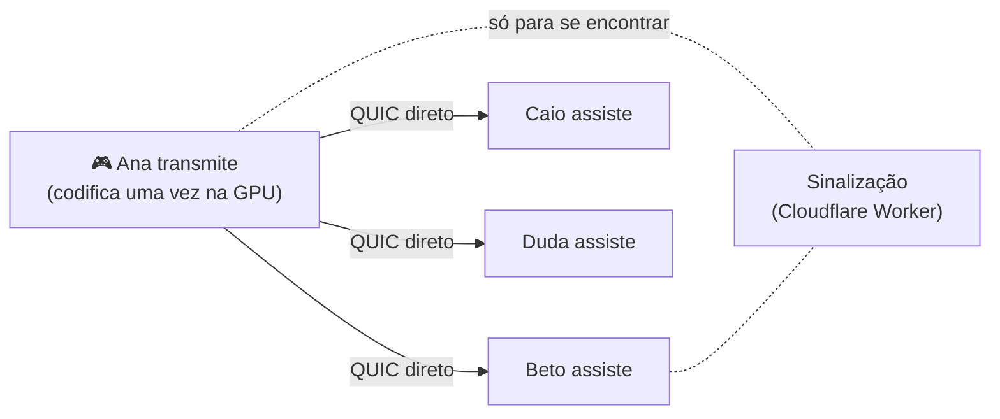

<p align="center">
  
</p>

<h1 align="center">SquadView</h1>

<p align="center">
  <a href="https://github.com/Kaique292/squadview/releases/latest"></a>
  <a href="https://github.com/Kaique292/squadview/actions/workflows/ci.yml"></a>
  <a href="https://github.com/Kaique292/squadview/actions/workflows/ci.yml"></a>
  <a href="https://github.com/Kaique292/squadview/releases"></a>
  
  
  
  <a href="LICENSE"></a>
  <a href="docs/git-e-versionamento.md"></a>
  <a href="https://buymeacoffee.com/kaiqueamaral"></a>
</p>

<p align="center">
  Compartilhe a tela com a galera da call em <b>1080p60</b>, com <b>baixa latência</b> e <b>quase sem pesar no jogo</b>.<br>
  Sem servidor de mídia: <b>o vídeo vai direto de um PC para o outro</b>, com o som do jogo e sem o som da call.
</p>

<p align="center">
  <a href="https://github.com/Kaique292/squadview/releases/latest"><b>⬇️ Baixar para Windows</b></a>
  &nbsp;·&nbsp;
  <a href="#-como-funciona">Como funciona</a>
  &nbsp;·&nbsp;
  <a href="docs/roadmap.md">Roadmap</a>
  &nbsp;·&nbsp;
  <a href="CONTRIBUTING.md">Contribuir</a>
  &nbsp;·&nbsp;
  <a href="#-in-english">English</a>
</p>

> [!NOTE]
> **Versão 0.1.0: o essencial já funciona.** Um amigo transmite e o resto da sala assiste dentro do app, direto de PC para PC. O repasse entre membros (a sala distribuindo o vídeo sozinha) chega na [Fase 3](docs/roadmap.md). Achou um problema? [Abra uma issue](https://github.com/Kaique292/squadview/issues).

## ✨ O que ele faz

**Já funciona (0.1.0)**

- **Qualidade de jogo.** Até 1440p ou a resolução da fonte, a 15, 30 ou 60 fps, tudo liberado. Encode por hardware na placa de vídeo (NVIDIA e AMD), e a imagem não sai da GPU, então o jogo quase não sente.
- **Direto de PC para PC.** O vídeo não passa por servidor. As conexões são cifradas (QUIC com TLS 1.3).
- **Só o áudio do jogo.** Transmitindo uma janela, vai só o som daquele app; o som da call fica de fora.
- **Assista dentro do app**, como no Discord: o vídeo aparece na janela, com tela cheia e estatísticas (fps, bitrate, latência e ping).
- **Salas com código.** Crie uma sala e mande o **link de convite**: quem tem o app entra direto, quem não tem cai na página de download.
- **Integração com o Discord.** Entre com a sua conta (nome e foto do Discord) e mostre no seu perfil que está numa sala, transmitindo ou assistindo. Se quiser, com o botão "Entrar na sala".
- **Visual que você já conhece.** Interface na organização do Discord, com identidade própria e efeito de vidro ajustável.
- **Sempre atualizado.** O app avisa quando sai versão nova e se atualiza com um clique, com pacotes assinados.
- **Registro de desempenho só no seu PC.** Pode ser desligado; um botão copia os arquivos para você mandar a quem for ajudar.

**Em breve**

- **A sala se ajuda (Fase 3).** Quem tem upload sobrando repassa o stream para os outros, e quem está jogando repassa o mínimo.
- **Internet fraca não derruba ninguém (Fase 3).** Quem está com conexão ruim recebe 720p, e o resto continua em 1080p.
- **Bot do Discord (Fase 5)** avisando no servidor quando alguém começar a transmitir.

## 📸 Telas

<p align="center">
  
</p>

<p align="center">
  
  &nbsp;
  
</p>

## 🧠 Como funciona



1. Quem transmite **codifica o vídeo uma vez** na placa de vídeo (NVENC na NVIDIA, AMF na AMD), sem copiar a imagem para o processador.
2. Cada amigo que clica em **Assistir** abre uma conexão **direta** com quem transmite. O app descobre o endereço público de cada um e "fura" o roteador (hole punching), sem precisar abrir portas.
3. Um serviço pequeno e gratuito só ajuda os PCs a se encontrarem: troca o código da sala e os endereços. **Nenhum vídeo passa por ele**, e ninguém precisa criar conta nele.
4. **Na Fase 3**, quem tem upload sobrando passa a repassar os pacotes prontos para os outros, sem recodificar, e a sala se reorganiza sozinha conforme a internet de cada um.

Detalhes técnicos em [docs/arquitetura.md](docs/arquitetura.md) e [docs/protocolo-malha.md](docs/protocolo-malha.md).

## 💻 Requisitos

|                          | Mínimo                        | Recomendado                    |
| ------------------------ | ----------------------------- | ------------------------------ |
| Sistema                  | Windows 10 (2004+)            | Windows 11                     |
| Placa de vídeo           | NVIDIA GTX 10xx ou AMD RX 400 | NVIDIA RTX 20xx ou AMD RX 6000 |
| Internet para transmitir | 10 Mbps de upload             | 20 Mbps+ de upload             |
| Internet para assistir   | 5 Mbps de download            | 15 Mbps+ de download           |

## ⬇️ Instalação

1. Baixe o instalador `SquadView_x.y.z_x64-setup.exe` na [última versão](https://github.com/Kaique292/squadview/releases/latest).
2. Abra e siga os passos. Não precisa ser administrador.
   - Se o Windows mostrar **"O Windows protegeu o computador"**, clique em **Mais informações → Executar assim mesmo**. O aviso aparece porque o instalador ainda não tem certificado de assinatura do Windows (que é pago); as atualizações são assinadas pelo projeto.
3. Crie uma sala, clique em **Convidar pessoas** (copia o link) e mande para a galera. Depois é só **Transmitir minha tela**.

Quer conferir se o arquivo é original? Compare o SHA-256 com o `SHA256SUMS.txt` da release:

```powershell
Get-FileHash .\SquadView_x.y.z_x64-setup.exe
```

## ❓ Perguntas frequentes

<details>
<summary><b>Vai pesar no meu jogo?</b></summary>

Muito pouco. A codificação é feita por um chip separado na placa de vídeo (NVENC), e a imagem não passa pelo processador. A meta do projeto é perder menos de 5% de FPS transmitindo em 1080p60, e cada versão é medida antes de sair.
</details>

<details>
<summary><b>Minha internet é CGNAT. Funciona?</b></summary>

Na maioria dos casos, sim: o app fura o roteador e conecta direto. Se as duas pontas estiverem atrás de um CGNAT muito restrito, a conexão pode falhar, e o app avisa. Na Fase 3, outro membro da sala que consegue falar com vocês dois vai poder fazer a ponte.
</details>

<details>
<summary><b>Tenho placa AMD. E aí?</b></summary>

Funciona. O app usa o encoder de hardware da placa pelo Media Foundation do Windows: NVENC na NVIDIA e AMF na AMD.
</details>

<details>
<summary><b>Meus amigos precisam de conta em algum lugar?</b></summary>

Não. É só instalar e entrar pelo link ou pelo código da sala. Entrar com o Discord é opcional e serve só para mostrar seu nome e sua foto.
</details>

<details>
<summary><b>Alguém da sala consegue ver ou mexer no meu stream?</b></summary>

As conexões são cifradas (QUIC com TLS 1.3). Só quem está na sala recebe o stream. Detalhes em [SECURITY.md](SECURITY.md).
</details>

<details>
<summary><b>É do Discord?</b></summary>

Não. O SquadView é um projeto independente e open source, sem ligação com o Discord. A integração usa só as APIs públicas do Discord.
</details>

## 🗺️ Roadmap

| Fase | Entrega                                                     | Status |
| ---- | ----------------------------------------------------------- | ------ |
| 0    | Fundação: estrutura, docs, esteira e atualização automática | ✅     |
| 1    | Captura + encode por hardware + preview local + áudio       | 🟨     |
| 2    | Transmissão direta entre os PCs da sala                     | 🟨     |
| 3    | Malha da sala (repasse entre membros)                       | ⬜     |
| 4    | App completo + login com Discord                            | 🟨     |
| 5    | AMD, Rich Presence, bot → **v1.0**                          | 🟨     |

Roadmap completo em [docs/roadmap.md](docs/roadmap.md).

## 🤝 Contribuir

Contribuições são muito bem-vindas! Leia o [CONTRIBUTING.md](CONTRIBUTING.md) e o [guia de desenvolvimento](docs/desenvolvimento.md). Resumo:

```powershell
git clone https://github.com/Kaique292/squadview.git
cd squadview
git switch dev
corepack enable
yarn install
yarn dev
```

PRs vão para a branch `dev`, com [commits semânticos](docs/git-e-versionamento.md).

## ☕ Apoie o projeto

O SquadView é gratuito e open source. Se ele salvou a sua jogatina, considere pagar um café:

<a href="https://buymeacoffee.com/kaiqueamaral"></a>

## 📄 Licença

[MIT](LICENSE) © 2026 Kaique Amaral

As miniaturas das janelas usam o crate `jpeg-encoder`: _this software is based in part on the work of the Independent JPEG Group_.

---

## 🇺🇸 In English

**SquadView** is a free, open-source Windows app for sharing your screen with friends on a call: game quality (1080p60), low latency and almost no FPS impact, thanks to hardware encoding (NVENC/AMF via Media Foundation) with a zero-copy GPU pipeline.

There is **no media server**: video goes directly between PCs over QUIC, with UDP hole punching. The plan (Phase 3) is for the room itself to distribute the video: members with spare upload relay already-encoded packets, and members on weak connections get a 720p layer. A tiny free signaling service (Cloudflare Worker) only helps peers find each other; no video goes through it.

- **Status:** version 0.1.0. One friend streams and the rest of the room watches inside the app, directly PC to PC (NVIDIA and AMD), with Discord login, invite links and Rich Presence. Relaying through the room (mesh) is Phase 3. See the [roadmap](docs/roadmap.md).
- **Stack:** Rust core, Tauri v2, React 19 + Tailwind v4, QUIC (quinn) peer-to-peer mesh, Cloudflare Worker for signaling.
- **Contributing:** PRs target the `dev` branch and use [Conventional Commits](https://www.conventionalcommits.org/). Docs are in Portuguese; issues and PRs in English are welcome too.
- **Support:** [Buy Me a Coffee](https://buymeacoffee.com/kaiqueamaral).
- **Not affiliated with Discord.**
