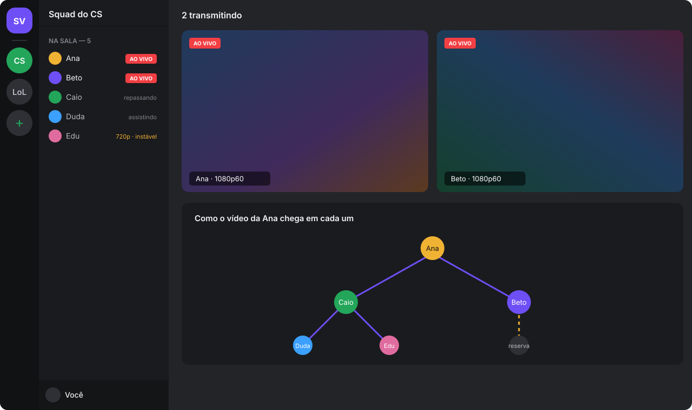
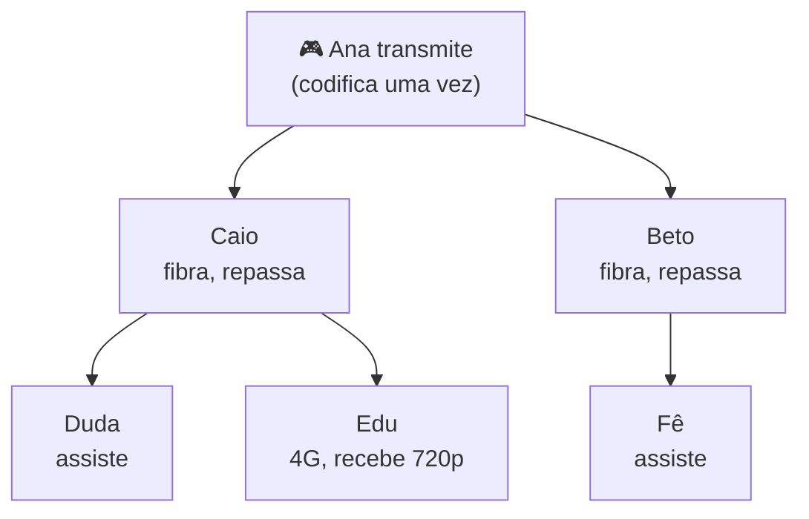

<p align="center">
  
</p>

<h1 align="center">SquadView</h1>

<p align="center">
  <a href="https://github.com/Kaique292/squadview/releases/latest"></a>
  <a href="https://github.com/Kaique292/squadview/actions/workflows/ci.yml"></a>
  <a href="https://github.com/Kaique292/squadview/actions/workflows/ci.yml"></a>
  <a href="https://github.com/Kaique292/squadview/releases"></a>
  
  
  
  <a href="LICENSE"></a>
  <a href="docs/git-e-versionamento.md"></a>
  <a href="https://buymeacoffee.com/kaiqueamaral"></a>
</p>

<p align="center">
  Compartilhe a tela com a galera da call em <b>1080p60</b>, com <b>baixa latência</b> e <b>quase sem pesar no jogo</b>.<br>
  Sem servidor: <b>a própria sala distribui o vídeo</b>, e quem tem internet melhor ajuda quem tem internet mais fraca.
</p>

<p align="center">
  <a href="https://github.com/Kaique292/squadview/releases/latest"><b>⬇️ Baixar para Windows</b></a>
  &nbsp;·&nbsp;
  <a href="#-como-funciona">Como funciona</a>
  &nbsp;·&nbsp;
  <a href="docs/roadmap.md">Roadmap</a>
  &nbsp;·&nbsp;
  <a href="CONTRIBUTING.md">Contribuir</a>
  &nbsp;·&nbsp;
  <a href="#-in-english">English</a>
</p>

> [!NOTE]
> **Projeto em construção.** Estamos na [Fase 0 (fundação)](docs/roadmap.md). O app ainda não transmite; acompanhe o roadmap ou ajude a construir.

## ✨ O que ele faz

- **Qualidade de jogo.** 1080p60 com encoder de hardware da placa de vídeo (NVIDIA primeiro, AMD em seguida). A imagem não sai da GPU, então o jogo quase não sente.
- **Sem servidor.** Ninguém paga nada. O vídeo vai direto entre os PCs da sala.
- **A sala se ajuda.** Quem tem upload sobrando repassa o stream para os outros. Quem está jogando repassa o mínimo, para não ter lag na partida.
- **Internet fraca não derruba ninguém.** Quem está com conexão ruim recebe 720p, e o resto da sala continua em 1080p.
- **Vários streams ao mesmo tempo**, como no Discord: cada um transmite o seu jogo e você escolhe quem assistir.
- **Só o áudio do jogo.** O som da call não vai junto no stream.
- **Visual que você já conhece.** Interface inspirada na organização do Discord, com identidade própria.
- **Integração com o Discord** (planejada): login com a conta do Discord, botão "Assistir" no perfil e aviso no servidor quando alguém começar a transmitir.

## 📸 Telas

<p align="center">
  
</p>

<p align="center"><sub>Prévia conceitual. As telas reais entram aqui na Fase 4.</sub></p>

## 🧠 Como funciona



1. Quem transmite **codifica o vídeo uma vez** na placa de vídeo e envia para poucos amigos.
2. Esses amigos **repassam os pacotes prontos**, sem recodificar. Isso usa só a internet deles, quase nada de CPU ou GPU.
3. O app mede o tempo todo o upload, a latência e a perda de cada um e **reorganiza a sala** sozinho. Se alguém cair, quem dependia dele troca de caminho em menos de 1 segundo.
4. Um serviço pequeno e gratuito só ajuda os PCs a se encontrarem. **Nenhum vídeo passa por ele.**

Detalhes técnicos em [docs/arquitetura.md](docs/arquitetura.md) e [docs/protocolo-malha.md](docs/protocolo-malha.md).

## 💻 Requisitos

|                          | Mínimo                         | Recomendado                  |
| ------------------------ | ------------------------------ | ---------------------------- |
| Sistema                  | Windows 10 (2004+)             | Windows 11                   |
| Placa de vídeo           | NVIDIA GTX 10xx (AMD em breve) | NVIDIA RTX 20xx ou mais nova |
| Internet para transmitir | 10 Mbps de upload              | 20 Mbps+ de upload           |
| Internet para assistir   | 5 Mbps de download             | 15 Mbps+ de download         |

## ⬇️ Instalação

1. Baixe o instalador `SquadView_x.y.z_x64-setup.exe` na [última versão](https://github.com/Kaique292/squadview/releases/latest).
2. Abra e siga os passos. Não precisa ser administrador.
3. Crie uma sala, mande o código para a galera e transmita.

Quer conferir se o arquivo é original? Compare o SHA-256 com o `SHA256SUMS.txt` da release:

```powershell
Get-FileHash .\SquadView_x.y.z_x64-setup.exe
```

## ❓ Perguntas frequentes

<details>
<summary><b>Vai pesar no meu jogo?</b></summary>

Muito pouco. A codificação é feita por um chip separado na placa de vídeo (NVENC), e a imagem não passa pelo processador. A meta do projeto é perder menos de 5% de FPS transmitindo em 1080p60, e cada versão é medida antes de sair.
</details>

<details>
<summary><b>Minha internet é CGNAT. Funciona?</b></summary>

Na maioria dos casos, sim: o app tenta conexão direta e, se não der, outro membro da sala que consegue falar com você faz a ponte.
</details>

<details>
<summary><b>Tenho placa AMD. E aí?</b></summary>

O suporte a AMD (AMF) está planejado para a Fase 5. O código já é organizado para isso: cada fabricante é só um módulo novo.
</details>

<details>
<summary><b>Alguém da sala consegue ver ou mexer no meu stream?</b></summary>

As conexões são cifradas (QUIC com TLS 1.3). Só quem está na sala recebe o stream. Detalhes em [SECURITY.md](SECURITY.md).
</details>

<details>
<summary><b>É do Discord?</b></summary>

Não. O SquadView é um projeto independente e open source, sem ligação com o Discord. A integração usa só as APIs públicas do Discord.
</details>

## 🗺️ Roadmap

| Fase | Entrega                                    | Status |
| ---- | ------------------------------------------ | ------ |
| 0    | Fundação: estrutura, docs e esteira        | 🟨     |
| 1    | Captura + NVENC + preview local            | ⬜     |
| 2    | Transmissão entre 2 PCs                    | ⬜     |
| 3    | Malha da sala (repasse entre membros)      | ⬜     |
| 4    | App completo + login com Discord           | ⬜     |
| 5    | AMD, auto-update, Rich Presence → **v1.0** | ⬜     |

Roadmap completo em [docs/roadmap.md](docs/roadmap.md).

## 🤝 Contribuir

Contribuições são muito bem-vindas! Leia o [CONTRIBUTING.md](CONTRIBUTING.md) e o [guia de desenvolvimento](docs/desenvolvimento.md). Resumo:

```powershell
git clone https://github.com/Kaique292/squadview.git
cd squadview
git switch dev
corepack enable
yarn install
yarn dev
```

PRs vão para a branch `dev`, com [commits semânticos](docs/git-e-versionamento.md).

## ☕ Apoie o projeto

O SquadView é gratuito e open source. Se ele salvou a sua jogatina, considere pagar um café:

<a href="https://buymeacoffee.com/kaiqueamaral"></a>

## 📄 Licença

[MIT](LICENSE) © 2026 Kaique Amaral

---

## 🇺🇸 In English

**SquadView** is a free, open-source Windows app for sharing your screen with friends on a call: game quality (1080p60), low latency and almost no FPS impact, thanks to hardware encoding (NVENC) with a zero-copy GPU pipeline.

There is **no media server**: the room itself distributes the video. Members with spare upload relay already-encoded packets to others, and the app keeps re-balancing the room based on measured upload, latency and packet loss. Members on weak connections get a 720p layer without lowering quality for everyone else. A tiny free signaling service only helps peers find each other; no video goes through it.

- **Status:** early development (Phase 0). See the [roadmap](docs/roadmap.md).
- **Stack:** Rust core, Tauri v2, React 19 + Tailwind v4, QUIC (quinn) peer-to-peer mesh, Cloudflare Worker for signaling.
- **Contributing:** PRs target the `dev` branch and use [Conventional Commits](https://www.conventionalcommits.org/). Docs are in Portuguese; issues and PRs in English are welcome too.
- **Support:** [Buy Me a Coffee](https://buymeacoffee.com/kaiqueamaral).
- **Not affiliated with Discord.**
