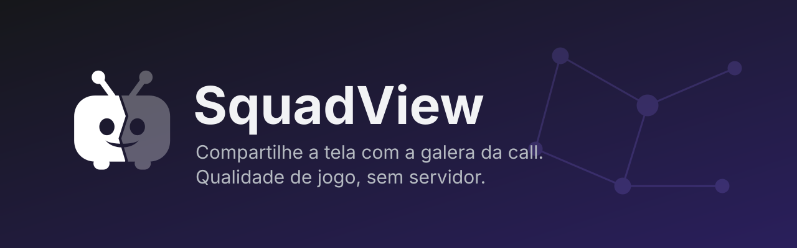
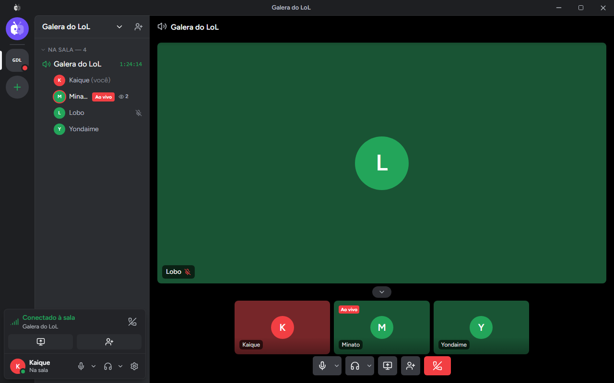
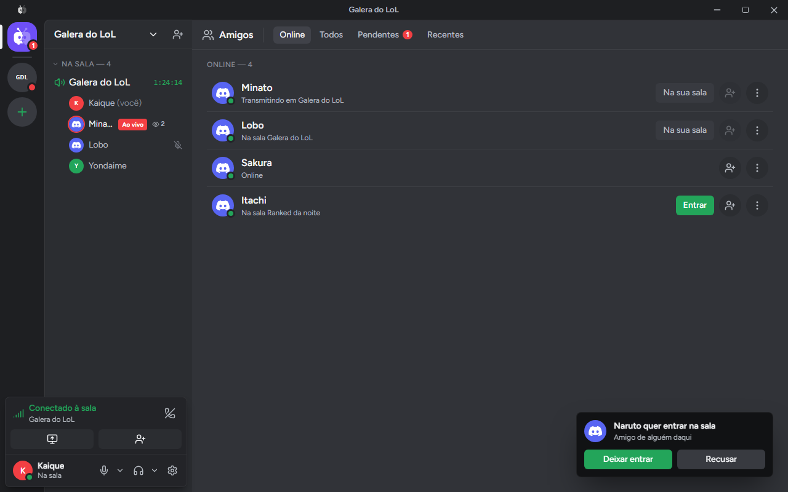
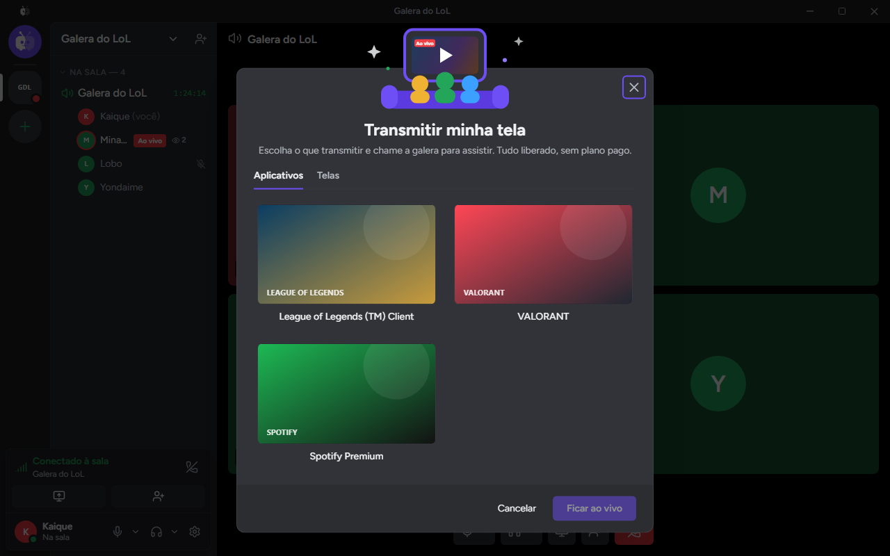
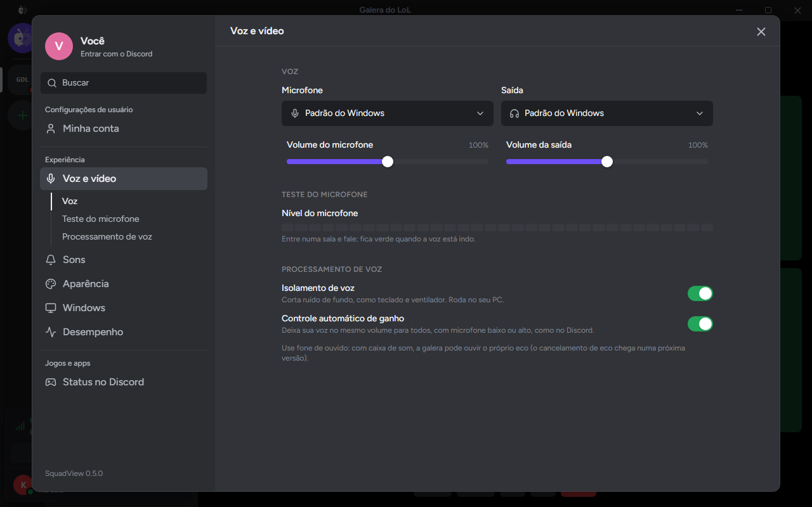
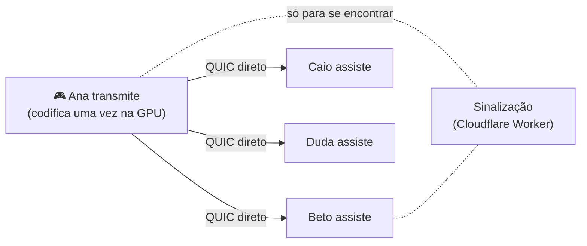

<p align="center">
  
</p>

<h1 align="center">SquadView</h1>

<p align="center">
  <a href="https://github.com/Kaique292/squadview/releases/latest"></a>
  <a href="https://github.com/Kaique292/squadview/actions/workflows/ci.yml"></a>
  <a href="https://github.com/Kaique292/squadview/actions/workflows/ci.yml"></a>
  <a href="https://github.com/Kaique292/squadview/releases"></a>
  
  
  
  <a href="LICENSE"></a>
  <a href="docs/git-e-versionamento.md"></a>
  <a href="https://buymeacoffee.com/kaiqueamaral"></a>
</p>

<p align="center">
  Compartilhe a tela com a galera da call em <b>1080p60</b>, com <b>baixa latência</b> e <b>quase sem pesar no jogo</b>.<br>
  Sem servidor de mídia: <b>o vídeo e a voz vão direto de um PC para o outro</b>, com o som do jogo e sem o som da call.
</p>

<p align="center">
  <a href="https://github.com/Kaique292/squadview/releases/latest"><b>⬇️ Baixar para Windows</b></a>
  &nbsp;·&nbsp;
  <a href="#-como-funciona">Como funciona</a>
  &nbsp;·&nbsp;
  <a href="docs/roadmap.md">Roadmap</a>
  &nbsp;·&nbsp;
  <a href="CONTRIBUTING.md">Contribuir</a>
  &nbsp;·&nbsp;
  <a href="#-in-english">English</a>
</p>

> [!NOTE]
> **Versão 0.5: conecta até atrás de CGNAT.** Quem não conseguia assistir um amigo por causa da internet da operadora agora conecta por IPv6 ou recebe o vídeo por quem já está assistindo. A live mostra quantos e quem estão vendo, o app toca sons de aviso como o Discord e, ao fechar a janela, fica na bandeja sem sair da sala. A sala inteira distribuindo o vídeo (salas sem limite) chega na [Fase 3](docs/roadmap.md). Achou um problema? [Abra uma issue](https://github.com/Kaique292/squadview/issues).

## ✨ O que ele faz

**Já funciona**

- **Qualidade de jogo.** Até 1440p ou a resolução da fonte, a 15, 30 ou 60 fps, tudo liberado. Encode por hardware na placa de vídeo (NVIDIA e AMD), e a imagem não sai da GPU, então o jogo quase não sente.
- **Direto de PC para PC.** O vídeo não passa por servidor. As conexões são cifradas (QUIC com TLS 1.3).
- **Jogue do jeito que quiser.** Janela, sem bordas ou tela cheia: escolha o jogo uma vez e o app acompanha sozinho do cliente para a partida e de volta (LoL, Valorant e jogos com launcher). Nada é injetado no jogo, então é seguro com Vanguard, EAC e BattlEye.
- **Só o áudio do jogo.** Transmitindo um jogo ou app, vai só o som dele, e o som acompanha quando o jogo troca de janela; o som da call fica de fora.
- **Assista dentro do app**, como no Discord: o vídeo aparece na janela, com tela cheia, volume de até 200% e estatísticas (fps, bitrate, latência e ping). Quem transmite vê quantos e quem estão assistindo.
- **Funciona atrás de CGNAT.** Se a conexão direta não fecha (internet da operadora, 4G), o app tenta por IPv6 e, se ainda não der, recebe o vídeo por alguém da sala que já está assistindo. Há também um repassador na nuvem pronto para ligar ([ADR 0014](docs/adr/0014-conexao-em-camadas.md)).
- **Chat de voz na sala.** A sala é um canal de voz como o do Discord: um quadro por pessoa, borda verde em quem fala, mudo e surdo, e clique num quadro para pôr a pessoa em foco. Volume e silenciar por pessoa (só para você), isolamento de voz contra teclado e ventilador e controle automático de ganho, para todo mundo chegar no mesmo volume. A voz também vai direto de PC para PC.
- **Amigos.** Veja quem está online, numa sala ou transmitindo. Peça para entrar na sala de um amigo (qualquer pessoa da sala aceita), chame amigos para a sua e marque quem entra direto. Adicione direto pelo botão direito em quem está na sala com você, ou depois, em Recentes.
- **Salas com nome e código.** Dê um nome à sala e mande o **link de convite**: quem tem o app entra direto, quem não tem cai na página de download.
- **Integração com o Discord.** Entre com a sua conta: seu nome e sua foto aparecem para toda a sala. Mostre no seu perfil do Discord que está numa sala, transmitindo ou assistindo, com o botão "Entrar na sala" se quiser.
- **Visual que você já conhece.** Interface na organização do Discord, com identidade própria, configurações por categoria e efeito de vidro ajustável. Sons de aviso ao entrar, sair, mutar, ensurdecer e transmitir (com volume e cada som desligável).
- **Fica na bandeja.** Fechar a janela deixa o app perto do relógio, e você continua na sala; clique no ícone para abrir ou use "Sair" no botão direito. Dá para desligar em Configurações › Windows.
- **Instala e atualiza como o Discord.** Sem assistente: o instalador termina em segundos e já abre o app. Se tiver versão nova quando você abre o app, ele já se atualiza ali, com uma barra para o download e outra para a instalação. Com o app aberto, a setinha verde aparece na barra de título; um clique e ele se atualiza. Os pacotes são assinados. Se você estiver numa sala, ele volta sozinho para ela, e mostra as novidades da versão.
- **Registro de desempenho só no seu PC.** Pode ser desligado; um botão copia os arquivos para você mandar a quem for ajudar.

**Em breve**

- **Salas sem limite (Fase 3).** A própria sala distribui o vídeo como um torrent, mas com atraso de call: com 5.000 pessoas, cerca de 60 ms de rede, e quem transmite manda sempre só 2 cópias ([ADR 0012](docs/adr/0012-malha-em-enxame.md)).
- **Internet fraca não derruba ninguém (Fase 3).** Quem está com conexão ruim recebe 720p, e o resto continua em 1080p.
- **Bot do Discord (Fase 5)** avisando no servidor quando alguém começar a transmitir.

## 📸 Telas

<p align="center">
  
</p>

<p align="center">
  
</p>

<p align="center">
  
  &nbsp;
  
</p>

## 🧠 Como funciona



1. Quem transmite **codifica o vídeo uma vez** na placa de vídeo (NVENC na NVIDIA, AMF na AMD), sem copiar a imagem para o processador.
2. Cada amigo que clica em **Assistir** abre uma conexão **direta** com quem transmite. O app descobre o endereço público de cada um e "fura" o roteador (hole punching), sem precisar abrir portas.
3. Um serviço pequeno e gratuito só ajuda os PCs a se encontrarem: troca o código da sala e os endereços. **Nenhum vídeo passa por ele**, e ninguém precisa criar conta nele.
4. **Na Fase 3**, quem tem upload sobrando passa a repassar os pacotes prontos para os outros, sem recodificar, e a sala se reorganiza sozinha conforme a internet de cada um.

Detalhes técnicos em [docs/arquitetura.md](docs/arquitetura.md) e [docs/protocolo-malha.md](docs/protocolo-malha.md).

## 💻 Requisitos

|                          | Mínimo                        | Recomendado                    |
| ------------------------ | ----------------------------- | ------------------------------ |
| Sistema                  | Windows 10 (2004+)            | Windows 11                     |
| Placa de vídeo           | NVIDIA GTX 10xx ou AMD RX 400 | NVIDIA RTX 20xx ou AMD RX 6000 |
| Internet para transmitir | 10 Mbps de upload             | 20 Mbps+ de upload             |
| Internet para assistir   | 5 Mbps de download            | 15 Mbps+ de download           |

## ⬇️ Instalação

1. Baixe o instalador `SquadView_x.y.z_x64-setup.exe` na [última versão](https://github.com/Kaique292/squadview/releases/latest).
2. Abra o instalador: ele instala em poucos segundos, sem perguntas, e já abre o SquadView. Não precisa ser administrador. (Quer escolher a pasta? Rode com `/WIZARD`.)
   - Se o Windows mostrar **"O Windows protegeu o computador"**, clique em **Mais informações → Executar assim mesmo**. O aviso aparece porque o instalador ainda não tem certificado de assinatura do Windows (que é pago); as atualizações são assinadas pelo projeto.
3. Crie uma sala, clique em **Convidar pessoas** (copia o link) e mande para a galera. Depois é só **Transmitir minha tela**.

Quer conferir se o arquivo é original? Compare o SHA-256 com o `SHA256SUMS.txt` da release:

```powershell
Get-FileHash .\SquadView_x.y.z_x64-setup.exe
```

## ❓ Perguntas frequentes

<details>
<summary><b>Vai pesar no meu jogo?</b></summary>

Muito pouco. A codificação é feita por um chip separado na placa de vídeo (NVENC), e a imagem não passa pelo processador. A meta do projeto é perder menos de 5% de FPS transmitindo em 1080p60, e cada versão é medida antes de sair.
</details>

<details>
<summary><b>Jogo em tela cheia. Preciso mudar alguma coisa?</b></summary>

Não. Janela, sem bordas ou tela cheia funcionam do mesmo jeito. Escolha o jogo (ou o cliente dele, como o do LoL) e o SquadView acompanha sozinho quando a partida abre em outra janela. Se o jogo entrar em tela cheia sem mandar imagem para a janela, o app passa a transmitir o monitor dele, e volta para a janela quando você sai da tela cheia.
</details>

<details>
<summary><b>Minha internet é CGNAT. Funciona?</b></summary>

Sim, na grande maioria dos casos. Primeiro o app fura o roteador e conecta direto. Se não der, tenta por IPv6, que não tem CGNAT (muitas operadoras já entregam). Se ainda não der, quem já está assistindo a live repassa o vídeo para você. Só falha se as duas pontas estiverem atrás de CGNAT, sem IPv6 e sem ninguém na sala que alcance vocês dois, e aí o app avisa. Para esse caso há um repassador na nuvem pronto, desligado por enquanto ([ADR 0014](docs/adr/0014-conexao-em-camadas.md)).
</details>

<details>
<summary><b>Tenho placa AMD. E aí?</b></summary>

Funciona. O app usa o encoder de hardware da placa pelo Media Foundation do Windows: NVENC na NVIDIA e AMF na AMD.
</details>

<details>
<summary><b>Meus amigos precisam de conta em algum lugar?</b></summary>

Não. É só instalar e entrar pelo link ou pelo código da sala. Entrar com o Discord é opcional: serve para mostrar seu nome e sua foto e para usar os amigos (ver quem está online e pedir para entrar na sala deles). O SquadView só lê seu perfil público do Discord, nunca suas mensagens, servidores ou amigos de lá.
</details>

<details>
<summary><b>Alguém da sala consegue ver ou mexer no meu stream?</b></summary>

As conexões são cifradas (QUIC com TLS 1.3). Só quem está na sala recebe o stream. Detalhes em [SECURITY.md](SECURITY.md).
</details>

<details>
<summary><b>É do Discord?</b></summary>

Não. O SquadView é um projeto independente e open source, sem ligação com o Discord. A integração usa só as APIs públicas do Discord.
</details>

## 🗺️ Roadmap

| Fase | Entrega                                                     | Status |
| ---- | ----------------------------------------------------------- | ------ |
| 0    | Fundação: estrutura, docs, esteira e atualização automática | ✅     |
| 1    | Captura + encode por hardware + preview local + áudio       | 🟨     |
| 2    | Transmissão direta entre os PCs da sala                     | 🟨     |
| 3    | Malha da sala (repasse entre membros)                       | ⬜     |
| 4    | App completo + login com Discord                            | 🟨     |
| 5    | AMD, Rich Presence, bot → **v1.0**                          | 🟨     |

Roadmap completo em [docs/roadmap.md](docs/roadmap.md).

## 🤝 Contribuir

Contribuições são muito bem-vindas! Leia o [CONTRIBUTING.md](CONTRIBUTING.md) e o [guia de desenvolvimento](docs/desenvolvimento.md). Resumo:

```powershell
git clone https://github.com/Kaique292/squadview.git
cd squadview
git switch dev
corepack enable
yarn install
yarn dev
```

PRs vão para a branch `dev`, com [commits semânticos](docs/git-e-versionamento.md).

## ☕ Apoie o projeto

O SquadView é gratuito e open source. Se ele salvou a sua jogatina, considere pagar um café:

<a href="https://buymeacoffee.com/kaiqueamaral"></a>

## 📄 Licença

[MIT](LICENSE) © 2026 Kaique Amaral

As miniaturas das janelas usam o crate `jpeg-encoder`: _this software is based in part on the work of the Independent JPEG Group_.

---

## 🇺🇸 In English

**SquadView** is a free, open-source Windows app for sharing your screen with friends on a call: game quality (1080p60), low latency and almost no FPS impact, thanks to hardware encoding (NVENC/AMF via Media Foundation) with a zero-copy GPU pipeline.

There is **no media server**: video goes directly between PCs over QUIC, with UDP hole punching. The plan (Phase 3) is for the room itself to distribute the video: members with spare upload relay already-encoded packets, and members on weak connections get a 720p layer. A tiny free signaling service (Cloudflare Worker) only helps peers find each other; no video goes through it.

- **Status:** version 0.5. One friend streams and the rest of the room watches inside the app, directly PC to PC (NVIDIA and AMD), with a live viewer count. Members behind CGNAT connect over IPv6 or get the stream relayed by someone already watching; an optional cloud TURN relay is ready to turn on. The room is a Discord-like voice channel (peer-to-peer Opus voice with noise suppression), with friends, presence, "ask to join" requests, notification sounds and a system tray icon. Discord login, invite links, Rich Presence and a silent Discord-style installer. Full room-wide relaying (mesh) is Phase 3. See the [roadmap](docs/roadmap.md).
- **Stack:** Rust core, Tauri v2, React 19 + Tailwind v4, QUIC (quinn) peer-to-peer mesh, Cloudflare Worker for signaling.
- **Contributing:** PRs target the `dev` branch and use [Conventional Commits](https://www.conventionalcommits.org/). Docs are in Portuguese; issues and PRs in English are welcome too.
- **Support:** [Buy Me a Coffee](https://buymeacoffee.com/kaiqueamaral).
- **Not affiliated with Discord.**
