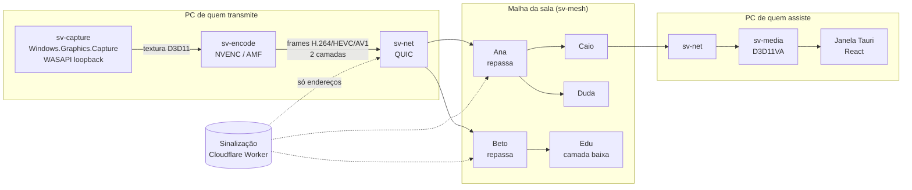

# Arquitetura

O SquadView é um único app de Windows que **transmite e assiste**. Não existe servidor de mídia: o vídeo sai do PC de quem transmite e é repassado pelos próprios membros da sala.

## Visão geral

## Princípios

1. **A imagem não sai da GPU.** A captura entrega uma textura D3D11 que vai direto para o encoder de hardware. Nenhuma cópia para a CPU. É isso que mantém o FPS do jogo.
2. **Codifica uma vez, repassa muitas.** Quem repassa só encaminha pacotes já codificados: nada de decodificar e recodificar. Repassar custa upload, quase nada de CPU.
3. **Quem joga trabalha menos.** A malha evita usar como repassador quem está em partida online.
4. **Internet fraca não derruba ninguém.** Duas camadas de qualidade (1080p60 e 720p30); cada membro recebe a que aguenta.
5. **Sem servidor de mídia.** A sinalização só troca endereços. Se dois membros não se enxergam (CGNAT), tentam por IPv6, depois por um repassador TURN opcional e por quem já assiste o mesmo stream ([ADR 0014](adr/0014-conexao-em-camadas.md)).

## Crates e responsabilidades

| Crate                | Responsabilidade                                                      | Fase  |
| -------------------- | --------------------------------------------------------------------- | ----- |
| `sv-core`            | Tipos comuns: `PeerId`, `QualityLayer`, erros, configuração           | 0     |
| `sv-capture`         | Captura de tela (WGC) e de áudio do processo do jogo (WASAPI)         | 1     |
| `sv-encode`          | Trait `Encoder` + implementações NVENC e AMF                          | 1 / 5 |
| `sv-media`           | Decode por GPU, renderização, áudio Opus                              | 1     |
| `sv-net`             | QUIC (quinn), hole punching, enquadramento de pacotes                 | 2     |
| `sv-mesh`            | Árvore de repasse, medição, troca de pai — lógica pura e testável     | 3     |
| `apps/desktop`       | App Tauri: janela, interface React, comandos que ligam a UI ao núcleo | 0 → 4 |
| `services/signaling` | Worker da Cloudflare: cria salas e troca candidatos de endereço       | 2     |

Regra de dependência: `sv-core` não depende de ninguém; `sv-mesh` não depende de `sv-net` (recebe medições e devolve decisões), para poder ser testado sem rede.

## Configuração de encode para baixa latência

- Sem B-frames, GOP longo com keyframe sob demanda (quando alguém entra ou perde pacotes demais).
- Bitrate constante (CBR) com buffer curto, preset de baixa latência do NVENC.
- Camada alta: 1080p60 a ~8 Mbps. Camada baixa: 720p30 a ~2,5 Mbps.
- H.264 por padrão; HEVC/AV1 quando todos da sala suportam.

## Orçamento de latência (meta)

| Etapa                            | Meta         |
| -------------------------------- | ------------ |
| Captura + encode                 | < 10 ms      |
| Cada salto na malha              | 10–30 ms     |
| Decode + exibição                | < 10 ms      |
| **Ponta a ponta (até 2 saltos)** | **< 100 ms** |

## Segurança

- Conexões QUIC com TLS 1.3; cada sala gera suas chaves e os membros conferem a identidade uns dos outros pela sinalização.
- Meta da Fase 3: membros que repassam encaminham a mídia cifrada de ponta a ponta pelo streamer, sem poder alterá-la (detalhes em [protocolo-malha.md](protocolo-malha.md)).
- Sem telemetria.
