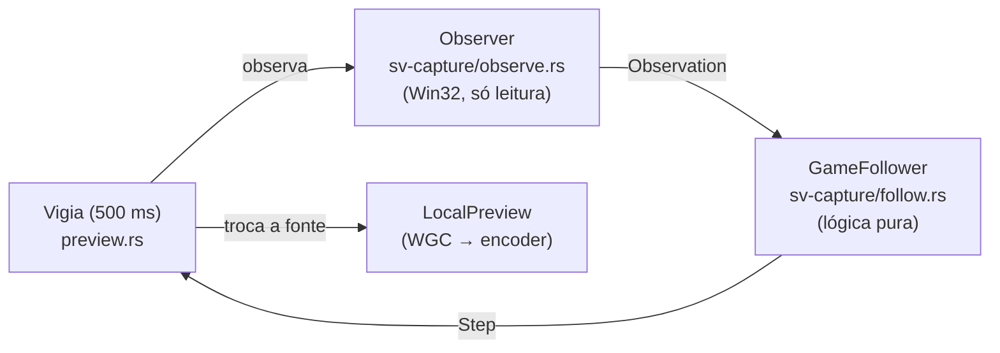

# Captura: qualquer modo de tela, seguindo o jogo

Como o SquadView captura o jogo e por que ele **nunca** pede para o jogador mudar nada no jogo. A decisão está registrada na [ADR 0013](adr/0013-seguir-o-jogo-sem-injecao.md).

## O problema que originou isto

O Kaique escolheu transmitir o **cliente do League of Legends** (`LeagueClientUx.exe`, o lobby). Quando a partida começou, o jogo abriu **outra janela, de outro processo** (`Game\League of Legends.exe`) em tela cheia. O cliente continuou vivo, só escondido. Como o app só trocava de janela quando a antiga **morria**, a imagem congelou no lobby e apareceu um aviso pedindo para trocar o jogo para "janela sem bordas". Eles jogam sempre em tela cheia: o app tem que se virar.

## Requisitos (e o porquê)

1. **Qualquer modo de tela funciona** (janela, sem bordas, tela cheia exclusiva) sem o jogador mudar o jogo.
   _Por quê:_ quem joga não quer (e não deveria precisar) mexer nas opções de vídeo para transmitir. Tela cheia exclusiva costuma dar mais FPS e menos atraso de entrada; pedir para abrir mão disso é pedir para jogar pior.
2. **Escolheu o jogo, o app segue o jogo**: cliente → partida → cliente, sozinho (LoL, Valorant, qualquer jogo com launcher).
   _Por quê:_ para quem joga, "o jogo" é uma coisa só; que sejam dois processos é detalhe de implementação da Riot. Durante a partida ninguém vai dar alt-tab para trocar a fonte.
3. **Sem injeção no processo do jogo.** Nada de "game capture" estilo OBS (hook no `Present`). Só APIs do Windows: Windows.Graphics.Capture (janela e monitor) e, se um dia precisar, DXGI Desktop Duplication.
   _Por quê:_ anti-cheats de kernel (Vanguard, EAC, BattlEye) tratam DLL injetada no jogo como trapaça e podem **banir a conta**. Um app de transmissão entre amigos não pode correr esse risco.
4. **O áudio do jogo continua, seguindo o processo novo.** Se o áudio escolhido era o do processo do cliente, ele passa para o processo da partida (e volta).
   _Por quê:_ sem isso a partida ficaria muda (o cliente do LoL fica em silêncio durante o jogo).
5. **Desempenho:** a imagem não sai da GPU, nada de alocação por frame, nada de lock disputado na thread de mídia. A checagem de janelas e de primeiro plano roda **no vigia, a cada 500 ms**, nunca no caminho do frame.
   _Por quê:_ o app roda ao lado do jogo (ver `CLAUDE.md`). Enumerar janelas e abrir processos custa milissegundos; feito por frame, custaria FPS do jogo.
6. **Aviso só quando não há imagem mesmo**, com orientação útil (ex.: "o jogo está minimizado") e **sem pedir para trocar o modo de tela**. Os avisos de troca ("Agora transmitindo “…”.", "Jogo em tela cheia: transmitindo o monitor dele.") são informativos e curtos.
   _Por quê:_ aviso que não ajuda vira ruído, e aviso que manda mexer no jogo contradiz o requisito 1.

## Como funciona

- **`family.rs`**: decide quem é "do mesmo jogo".
- **`follow.rs`**: estado + fatos observados → ação. Não chama o Windows; é testado com cenários (cliente → partida → cliente, launcher que fecha, jogo minimizado, alt-tab para a área de trabalho, dois monitores).
- **`observe.rs`**: as consultas ao Windows (janelas de primeiro plano, retângulos, monitores, caminho dos executáveis). Primeiro o barato (processo, estilo, dono) para as centenas de janelas do sistema; título e geometria só para as da família. Os caminhos dos executáveis ficam guardados por 10 s.
- **`preview.rs` (`watch`)**: a cada 500 ms, observa, pergunta ao `GameFollower` e troca a captura quando ele manda. Não segura o lock da prévia enquanto consulta o Windows.

### Família do jogo

Duas janelas são do mesmo jogo quando têm o **mesmo processo**, o **mesmo executável** ou a **mesma pasta de instalação**. A pasta de instalação é a pasta logo abaixo da pasta "que guarda vários programas" mais funda do caminho:

| Executável                                                                     | Pasta de instalação                              |
| ------------------------------------------------------------------------------ | ------------------------------------------------ |
| `C:\Riot Games\League of Legends\LeagueClientUx.exe`                           | `C:\Riot Games\League of Legends\`               |
| `C:\Riot Games\League of Legends\Game\League of Legends.exe`                   | `C:\Riot Games\League of Legends\`               |
| `C:\Riot Games\VALORANT\live\ShooterGame\Binaries\Win64\VALORANT-Win64-...exe` | `C:\Riot Games\VALORANT\`                        |
| `D:\SteamLibrary\steamapps\common\Apex Legends\r5apex.exe`                     | `D:\SteamLibrary\steamapps\common\Apex Legends\` |
| `C:\Program Files\Epic Games\Fortnite\FortniteGame\Binaries\Win64\...exe`      | `C:\Program Files\Epic Games\Fortnite\`          |
| `D:\LoL\Game\League of Legends.exe` (nada genérico no caminho)                 | `D:\LoL\`                                        |

Pastas "que guardam vários programas": `Program Files`, `Program Files (x86)`, `Common Files`, `WindowsApps`, `XboxGames`, `Riot Games`, `Epic Games`, `GOG Games`, `EA Games`, `Games`, `Jogos`, `steamapps\common`, `AppData` (`Local`, `LocalLow`, `Roaming`, `Programs`), `Desktop`, `Documents`, `Downloads` e `Users\<nome>`. Executável solto numa dessas pastas, ou sob `Windows`/`ProgramData`, não forma família (só vale o mesmo processo ou o mesmo executável).

_Por quê assim:_ não depende de uma lista de jogos (funciona com qualquer jogo instalado por qualquer loja) e separa jogos diferentes da mesma loja (`steamapps\common\A` ≠ `steamapps\common\B`), o próprio launcher da loja (`Steam\steam.exe`, `Riot Client`) e programas que só dividem `Program Files`.

### Seguir o jogo

A cada checagem, nesta ordem:

1. **A janela atual sumiu ou foi escondida** (o cliente do LoL ao começar a partida) → segue, **na hora**, a janela da família que está em primeiro plano; senão, a maior janela visível da família. Minimizada não conta como sumida: o jogador volta para ela.
2. **Outra janela da família ficou em primeiro plano por 2 checagens seguidas (1 s)** → segue ela. Cobre os launchers que continuam visíveis atrás do jogo. As 2 checagens evitam trocar por uma tela de carregamento que aparece por um instante.
3. Janelas pequenas (menos de 1/8 do monitor: avisos, notificações) nunca viram a fonte.
4. **O jogo fechou e não há janela visível da família** → captura uma janela da família que ainda existe escondida (de preferência a escolhida, como o cliente do LoL que reaparece no fim da partida). Se não houver nenhuma, espera ("“…” sumiu. Esperando a janela do jogo voltar…") por até 5 s, o tempo de um launcher que fecha antes de a janela do jogo abrir. Passado isso, o programa fechou de vez e a transmissão **para** (com o fliperama, se estiver aberto). Vale para qualquer programa transmitido, não só jogos.

### Tela cheia

O Windows.Graphics.Capture de **janela** funciona com tela cheia "otimizada" (o padrão no Windows 10/11, inclusive DX12 flip e DX11 com `SetFullscreenState`, que o Windows promove a flip). Quando ainda assim a captura da janela para de entregar quadros (tela cheia exclusiva de verdade, com as otimizações desligadas), o vigia captura **o monitor do jogo**:

- **Vai para o monitor** quando a janela do jogo cobre o monitor inteiro (retângulo da janela = retângulo do monitor), está visível, **ninguém de fora do jogo está na frente dela naquele monitor** e a captura da janela está há **2 s** sem quadros. Um jogo desenha sem parar, então 2 s sem quadros é captura quebrada, não tela parada.
- **Volta para a janela**, na hora, quando o jogo sai da tela cheia, é minimizado (alt-tab em tela cheia exclusiva minimiza o jogo), muda de monitor ou **outra janela fica na frente dele naquele monitor** (alt-tab em sem bordas). _Por quê na hora:_ capturando o monitor, o que estiver na frente do jogo (Discord, navegador, área de trabalho) iria para a sala. Uma janela em outro monitor não atrapalha.
- **O jogo fechou de vez enquanto o monitor estava sendo capturado** (sem nenhuma janela da família) → a transmissão **para**. _Por quê:_ continuar mostraria a área de trabalho para a sala.

A comparação usa `GetWindowRect`: uma janela maximizada passa um pouco do monitor (as bordas invisíveis) e não conta como tela cheia; a de um jogo em tela cheia, exclusiva ou sem bordas, é exatamente o monitor.

### Avisos

| Situação                                            | Aviso                                                                                             |
| --------------------------------------------------- | ------------------------------------------------------------------------------------------------- |
| Seguiu outra janela do jogo                         | "Agora transmitindo “…”." (informativo)                                                           |
| Passou a capturar o monitor                         | "Jogo em tela cheia: transmitindo o monitor dele." (informativo)                                  |
| Voltou para a janela                                | "Transmitindo a janela de “…” de novo." (informativo)                                             |
| Janela escondida/fechada, nenhuma outra do jogo     | "“…” sumiu. Esperando a janela do jogo voltar…"                                                   |
| Sem quadros há 4 s e o jogo minimizado              | "“…” está minimizado. A imagem volta quando você abrir o jogo de novo."                           |
| Sem quadros, jogo em tela cheia com outra na frente | "Outra janela está na frente de “…”. A imagem volta quando o jogo voltar para a frente."          |
| Sem quadros por outro motivo                        | "Nenhuma imagem nova de “…” há alguns segundos. Se o jogo estiver carregando, ela volta sozinha." |

Capturando um monitor, tela parada não gera aviso (a área de trabalho parada não manda quadros e está tudo certo).

## Desempenho

- O caminho do frame não mudou: WGC → textura D3D11 → encoder, sem cópia para a CPU nem alocação por frame.
- A checagem roda no vigia (thread própria, 2 vezes por segundo), sem segurar o lock da prévia. Medido nesta máquina (Windows 11, RTX 3060, 350 a 370 janelas de primeiro nível, build de release, teste `custo_da_checagem_do_vigia`, 200 checagens): **mediana 0,25 a 0,6 ms, p95 2,3 a 3,8 ms** (a p95 é a checagem que renova os caminhos dos executáveis, a cada 10 s).
- Cada troca de fonte reinicia a captura e o encoder (como já acontecia quando a janela morria): há um keyframe novo e um instante sem imagem.

## Testes

- Lógica pura (`family.rs`, `follow.rs`): roda na esteira.
- Observação com janelas de verdade (`observe.rs`): roda na esteira (há sessão de desktop).
- `jogo_em_tela_cheia_sempre_tem_imagem` (`#[ignore]`, precisa de GPU e ocupa a tela uns 15 s): abre um "jogo" D3D11 em tela cheia sem bordas (flip) e exclusiva (`SetFullscreenState`), confere que a tela cheia é detectada, conta os quadros da captura de janela e de monitor e roda o vigia de verdade. Rode com `cargo test -p sv-capture --release -- --ignored --nocapture jogo_em_tela_cheia`.

## Limites conhecidos

- Tela cheia exclusiva **legada de verdade** (otimizações de tela cheia desligadas nas propriedades do executável, ou jogos DX9 antigos): o DWM pode não compor a tela e o WGC (janela e monitor) pode não receber quadros. Não foi possível reproduzir isso aqui (o Windows 11 promoveu o `SetFullscreenState` do teste a tela cheia otimizada). O próximo passo, se aparecer na prática, é a DXGI Desktop Duplication (sem injeção) como terceira opção.
- Um jogo rodando como administrador não deixa consultar o caminho do executável: a família fica restrita ao mesmo processo.
- Seguir a janela da família em primeiro plano tem 1 s de atraso de propósito (as 2 checagens).
