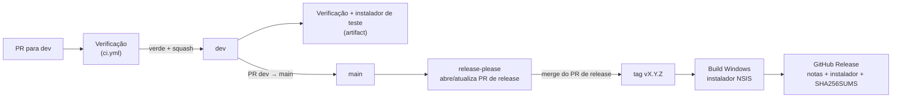

# Esteira (CI/CD)

## Visão geral

## Verificação (`.github/workflows/ci.yml`)

Roda em todo PR e em todo push na `dev` e na `main`.

| Job                     | Onde    | O que confere                                                                               |
| ----------------------- | ------- | ------------------------------------------------------------------------------------------- |
| Qualidade               | Ubuntu  | Prettier, commitlint em todos os commits do PR, título do PR semântico, `cargo fmt --check` |
| Dependências            | Ubuntu  | `cargo deny`: licenças permitidas, vulnerabilidades conhecidas e origem dos crates          |
| Rust                    | Windows | `cargo clippy -D warnings`, `cargo llvm-cov` (testes + cobertura)                           |
| Interface e sinalização | Ubuntu  | ESLint, TypeScript, Vitest com cobertura                                                    |
| Badge de cobertura      | Ubuntu  | Junta as coberturas; em push na `main`, publica o JSON na branch `badges`                   |
| Instalador de teste     | Windows | Em push na `dev`: `tauri build` e anexa o instalador como artifact do run                   |

## Release (`.github/workflows/release.yml`)

1. Todo push na `main` roda o **release-please**, que abre ou atualiza um PR "chore(release): versão X.Y.Z" com a versão nova e o changelog.
2. Ao fazer merge desse PR, o release-please cria a **tag** `vX.Y.Z` e a **GitHub Release**.
3. O job de build (Windows) roda `yarn build:release`, que gera o instalador NSIS **assinado**, e `scripts/updater-manifest.mjs`, que monta o `latest.json`. Tudo é anexado à Release: `SquadView_X.Y.Z_x64-setup.exe`, `.sig`, `latest.json` e `SHA256SUMS.txt`.
4. Os apps instalados consultam o `latest.json` da última Release ao abrir e oferecem a atualização (ver [ADR 0006](adr/0006-atualizacao-automatica.md)).

### Como publicar uma versão

1. Garanta que a `dev` está verde.
2. Abra o PR `dev → main` (skill `release` do Claude ou `gh pr create --base main --head dev`).
3. Faça merge com **merge commit**.
4. Revise o PR de release que o release-please abriu (versão e changelog) e faça merge.
5. Confira a Release e teste o instalador.

## Segredos e permissões

| Item                                                               | Para quê                                           | Quando                                              |
| ------------------------------------------------------------------ | -------------------------------------------------- | --------------------------------------------------- |
| `GITHUB_TOKEN` (automático)                                        | release-please, Releases, branch `badges`          | já                                                  |
| `TAURI_SIGNING_PRIVATE_KEY` e `TAURI_SIGNING_PRIVATE_KEY_PASSWORD` | Assinar o instalador para a atualização automática | já (chave guardada fora do repositório, com backup) |
| Certificado de assinatura de código                                | Evitar o aviso do SmartScreen                      | Opcional, quando houver orçamento                   |

Em **Settings → Actions → General**, deixe ativo "Allow GitHub Actions to create and approve pull requests" para o release-please conseguir abrir o PR.

## Proteção de branches

Em `main` e `dev`:

- PR obrigatório antes do merge.
- Checks da Verificação obrigatórios.
- Sem force-push e sem deleção.
- `main` aceita só merge commit; `dev` só squash.

## Dependabot

Atualizações semanais de `cargo`, `npm` e `github-actions`, sempre com PR para a `dev` e mensagens semânticas (`build(deps):`, `ci(deps):`). As Actions são fixadas por SHA de commit.
