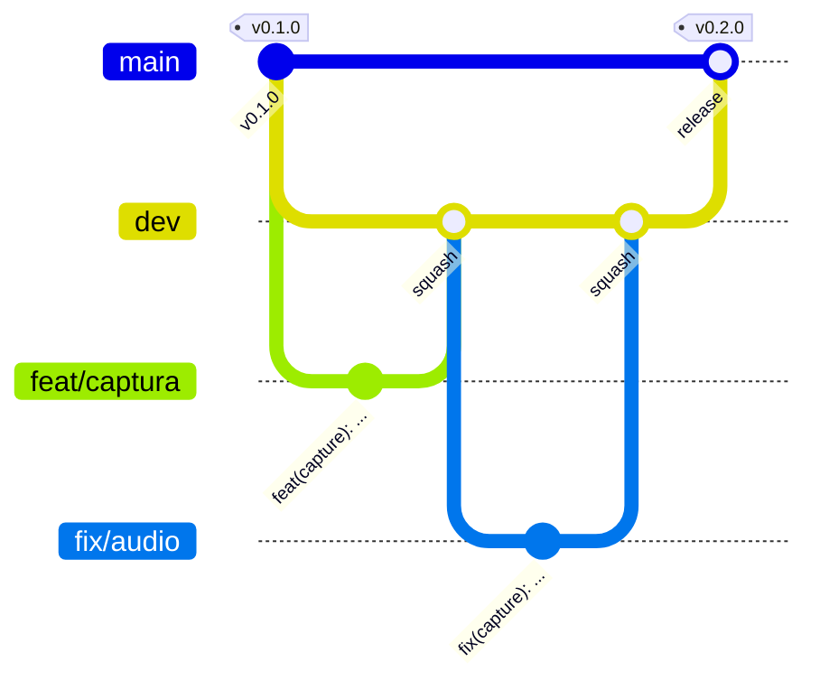

# Git e versionamento

## Branches



| Branch                                           | Papel                                         | Recebe                       |
| ------------------------------------------------ | --------------------------------------------- | ---------------------------- |
| `main`                                           | **Produção.** Cada release sai daqui.         | Só PRs vindos da `dev`       |
| `dev`                                            | **Integração.** Branch padrão do repositório. | PRs das branches de trabalho |
| `feat/*`, `fix/*`, `perf/*`, `docs/*`, `chore/*` | Trabalho do dia a dia                         | —                            |

- Branches de trabalho saem da `dev` e voltam para a `dev` por PR, com **squash merge**. O título do PR vira o commit, então ele precisa ser semântico.
- A `dev` vai para a `main` por PR com **merge commit**, para o release-please enxergar cada commit.
- Ninguém dá push direto nem force-push em `main` ou `dev`.

## Commits semânticos

Padrão [Conventional Commits](https://www.conventionalcommits.org/pt-br/), conferido pelo commitlint no hook `commit-msg` e no CI.

```
<tipo>(<escopo>): <resumo no imperativo, em português>

<corpo opcional: o porquê da mudança>

<rodapé opcional: BREAKING CHANGE: ..., Closes #12>
```

### Tipos

| Tipo       | Quando usar                               | Aparece no changelog? | Versão |
| ---------- | ----------------------------------------- | --------------------- | ------ |
| `feat`     | Recurso novo                              | ✨ Novidades          | minor  |
| `fix`      | Correção de bug                           | 🐛 Correções          | patch  |
| `perf`     | Melhoria de desempenho                    | ⚡ Desempenho         | patch  |
| `refactor` | Mudança interna sem alterar comportamento | ♻️ Melhorias internas | patch  |
| `docs`     | Documentação                              | 📝 Documentação       | patch  |
| `build`    | Build, dependências, instalador           | 📦 Build              | patch  |
| `test`     | Testes                                    | não                   | —      |
| `ci`       | Esteira                                   | não                   | —      |
| `chore`    | Manutenção geral                          | não                   | —      |
| `style`    | Formatação                                | não                   | —      |

`BREAKING CHANGE:` no rodapé (ou `!` depois do tipo, ex.: `feat(net)!:`) marca uma mudança incompatível.

### Escopos permitidos

`core`, `capture`, `encode`, `media`, `net`, `mesh`, `signal`, `ui`, `app`, `docs`, `ci`, `deps`, `deps-dev`, `release`. O escopo é opcional, mas recomendado. `deps-dev` é o que o Dependabot usa para dependências de desenvolvimento.

### Exemplos

```
feat(capture): captura janela específica pelo título
fix(mesh): evita escolher como pai quem está jogando
perf(encode): remove cópia da textura antes do NVENC
docs: explica como liberar o firewall
```

## Autoria única

O projeto tem **um único autor por commit**. Commits com o trailer `Co-authored-by:` são **recusados** pela regra `no-co-author` do commitlint, tanto no hook local quanto no CI. Isso vale para commits feitos com ajuda de ferramentas de IA: a configuração do Claude no projeto (`.claude/settings.json`) já desliga a assinatura automática. A única exceção são robôs do GitHub (`Co-authored-by: dependabot[bot] <…>`), que o próprio GitHub acrescenta ao fazer squash de um PR do Dependabot.

## Versionamento

- **SemVer** (`MAJOR.MINOR.PATCH`), com tags `vX.Y.Z`.
- Enquanto estivermos em `0.x`, um `feat` sobe o **minor** e uma quebra também sobe só o **minor** (`bump-minor-pre-major`). A `1.0.0` sai no fim da Fase 5.
- A versão é gerenciada pelo **release-please** e sincronizada automaticamente em `Cargo.toml`, `apps/desktop/package.json` e `tauri.conf.json`. **Nunca edite a versão à mão.**

## Changelog

O `CHANGELOG.md` é gerado pelo release-please a partir dos commits, com as seções em português da tabela acima. Para o changelog ficar bom, o resumo do commit tem que fazer sentido para quem usa o app.
